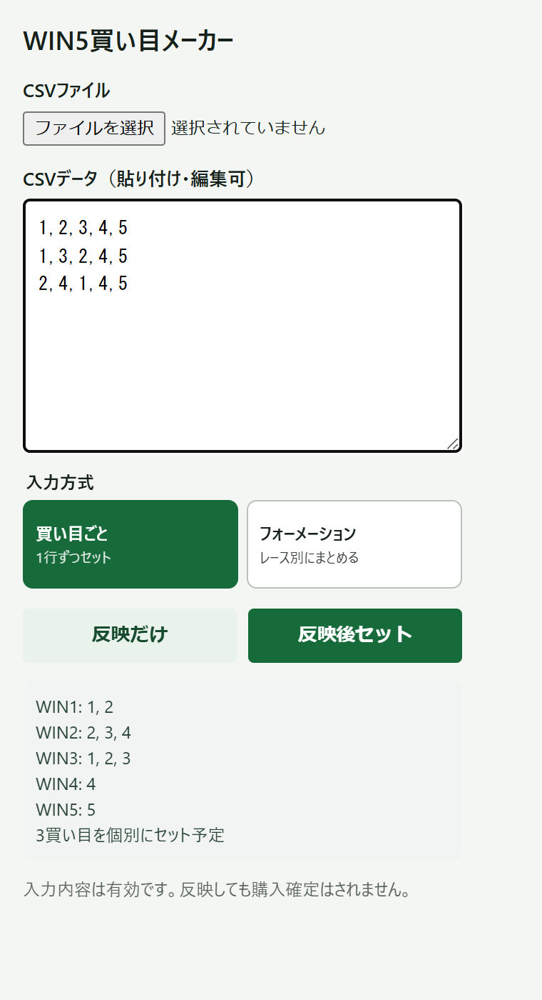

# WIN5買い目メーカー

WIN5の買い目をCSVからJRAネット投票 (即PAT) のWIN5選択画面へ入力するためのブラウザー用ツールです。
複数パターンの馬番の入力操作がしんどいのでcsvで一括入力補助をできるようにしています。



## 入力方式

既定の「買い目ごと」では、CSVの各行を1つずつセットします。「反映だけ」を選ぶと先頭行のみを選択欄に反映し、「反映後セット」を選ぶと各行を順にセットします。

「フォーメーション」では、各レースの馬番を行全体からまとめ、組合せを作ります。たとえば次のデータは、WIN1が1・2番、WIN2が2・3・4番、WIN3が1・2・3番、WIN4が4番、WIN5が5番となるフォーメーションです。

```csv
1,2,3,4,5
1,3,2,4,5
2,4,1,4,5
```

「反映だけ」は選択欄への反映、「反映後セット」はフォーメーション全体を1回セットします。

## Tampermonkeyで使う

1. Tampermonkeyの管理画面で新しいスクリプトを作成します。
2. [win5-ticket-builder.user.js](win5-ticket-builder.user.js) の内容を貼り付けて保存します。
3. JRAネット投票のWIN5「完全セレクト」画面を再読み込みします。
4. 画面右下のパネルでCSVを読み込み、入力方式を選んで操作します。

## Chrome拡張機能として使う

1. Chromeで `chrome://extensions` を開き、デベロッパーモードを有効にします。
2. 「パッケージ化されていない拡張機能を読み込む」を選び、[chrome-extension](chrome-extension) フォルダーを指定します。
3. JRAネット投票のWIN5「完全セレクト」画面で拡張機能のボタンを押します。
4. CSVを読み込み、入力方式を選んで「反映だけ」または「反映後セット」を選びます。

## CSV形式

ヘッダーなしの5列CSV、またはWIN1〜WIN5のヘッダー付きCSVを読み込めます。先頭列に口番号を含める場合は、ヘッダーでWIN1〜WIN5の列を指定してください。文字コードはUTF-8とShift_JISに対応しています。

```csv
口,WIN1,WIN2,WIN3,WIN4,WIN5
1,6,4,3,9,8
2,6,4,3,3,8
```

1行に5つの馬番を並べたハイフン区切り形式も使えます。

```text
6-4-3-9-8
6-4-3-3-8
```

## 注意事項

- CSVを反映すると、各レースで選択済みの馬番はCSVの内容に置き換わります。
- 馬番は1〜18で指定してください。
- 「セット」が無効の場合はそこで停止し、金額欄は変更しません。
- セット後は画面に表示された内容を確認してください。
